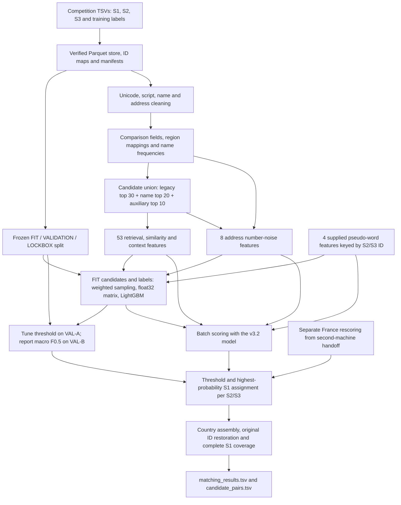

# AMLC 2026 — Business Entity Resolution

A business record matching system built for the **Amazon ML Challenge 2026**, developed during 25–27 September 2026. Given a query business in Source 1 (S1), the system finds every record in Source 2 or Source 3 (S2/S3) that refers to the same business.

The project combines multilingual text preparation, candidate retrieval, engineered similarity features, a LightGBM classifier, and constrained match assignment. The main pipeline was developed for a **16 GB Windows laptop**, with a second Ryzen machine supporting experiments and France rescoring.

**Team:** Divyansh Singh, Saksham Bansal, Siddharth Mohan Jha, Ayudh.

**Confirmed leaderboard result: 96.6% macro F0.5 with v3.2**, compared with 77.3% for the first v1 upload. These are recorded competition results, not results reproduced by cloning this repository.

## Problem and scale

- Training contains approximately **2.2 million S1 records and 7.64 million labelled links** from India and the US.
- Test contains approximately **1.73 million S1 records against 10 million S2/S3 records**, including France.
- **France has no training labels**, so validation on India and the US does not directly measure France performance.
- One S1 may match multiple S2/S3 records. Each S2/S3 record may be assigned to **at most one S1**.
- Competition constraints include no external record lookups or APIs and a final model with an eligible MIT/Apache-2.0 licence and at most 8 billion parameters. The production matcher uses LightGBM; pretrained embedding retrieval was evaluated separately and rejected.

The score is **macro F0.5**: calculate a score for each S1, then average across S1 records. Here **β = 0.5 and β² = 0.25**:

```text
F0.5 = 1.25 × precision × recall / (0.25 × precision + recall)
```

An S1 with no true matches scores 1 when its prediction is empty and 0 otherwise. An S1 with true matches scores 0 when none are recovered. The implementation is in [`eval/metric.py`](src/amlc/eval/metric.py).

## End-to-end architecture



Candidate generation narrows the search before classification. LightGBM scores only the retrieved pairs; a true link absent from that candidate set cannot be recovered by thresholding. This makes retrieval recall, match quality, and candidate-set size separate concerns.

### 1. Data foundation and evaluation boundaries

[`foundation/`](src/amlc/foundation/) converts raw TSVs to lossless Parquet, builds internal numeric IDs and labelled links, checks integrity, and records artifact hashes in manifests. Parquet provides portable intermediate files; Polars performs dataframe processing and DuckDB supports inspection.

The **70/20/10 FIT / VALIDATION / LOCKBOX split** is frozen with seed `20260925`, stratified by country and match-count bucket. Split membership must remain unchanged across experiments.

[`foundation/access.py`](src/amlc/foundation/access.py) verifies the foundation artifacts it serves and restricts label access:

- FIT labels are available for training and learning preprocessing mappings.
- Raw VALIDATION labels are accessible through [`eval/scorer.py`](src/amlc/eval/scorer.py); callers receive evaluation reports.
- LOCKBOX label access is restricted to [`eval/lockbox.py`](src/amlc/eval/lockbox.py) and logged as a single allowed read.
- [`foundation/leakscan.py`](src/amlc/foundation/leakscan.py) detects direct label reads that bypass the access layer. The Python access layer alone cannot prevent arbitrary file access.

The trainer also uses an **inner holdout from FIT** for early stopping. This is separate from VAL-A/VAL-B and from LOCKBOX.

### 2. Cleaning and comparison-ready records

[`cleaning/`](src/amlc/cleaning/) prepares names and addresses in stages: text normalization, script classification, a FIT-derived Indic-to-Latin dictionary, legal-form extraction, tokenization, and address component extraction. Unicode letters and combining marks are handled explicitly so accented Latin text is not mistaken for another script.

[`features/norm_v2.py`](src/amlc/features/norm_v2.py) builds the fields used by the final matcher:

- **Names:** core business name, no-space form, character skeleton, initials, first/last tokens, token count, legal form, and an Indic-script flag. Distinct non-ASCII strings are romanised with AnyAscii at this stage.
- **Addresses:** canonical address and street text, detected region, last component, house number, house-number digits, and postal code. Street normalization includes country-specific overrides.
- **Ambiguity:** the frequency of each core name in the corresponding S1 and S2/S3 country pools.

The native-script state mapping is learned from FIT pairs. Pool frequencies and retrieval IDF can use unlabelled test records; they do not require test ground truth.

### 3. Candidate generation: complementary retrieval paths

The v3.1 candidate set, also used by v3.2, is the deduplicated union of three ranked lists per S1:

1. **Top 30 legacy candidates** from the saved v1 retrieval files.
2. **Top 20 v3 name-path candidates**, using name/address token combinations and region/name keys.
3. **Top 10 auxiliary candidates** when `AMLC_KA=10`, ranked separately using address-token pairs and country-local exact names.

These budgets allow up to 60 distinct pairs per S1 before overlap between paths; actual candidate counts depend on the data. Separate ranking gives matches with changed names or missing addresses an additional route into the candidate set.

[`blocking/v3.py`](src/amlc/blocking/v3.py) defines five key kinds:

- `na`: core-name token × address token, excluding generic address words.
- `rns`: region × no-space name.
- `rsk`: region × character skeleton of the name.
- `aa`: unordered pairs of informative address tokens.
- `cns`: exact no-space name within the country pool.

Keys are hashed to `UInt64`. Per-kind frequency caps exclude overly common keys, and shared keys receive IDF-based retrieval scores. Scores and ranks from each retrieval path become model features. A pair absent from a path receives score `0.0` and rank `999` for that path.

[`pipeline/run_v31.py`](src/amlc/pipeline/run_v31.py) processes S1 in batches of 5,000 and keeps **name and auxiliary indexes out of memory at the same time**. FIT/VALIDATION reuse saved v3 name candidates. Test retrieval writes name candidates first, releases that index, and then builds the auxiliary index to complete the union and score it.

Recorded FIT-sample measurements for adding auxiliary top-10 candidates were:

- India retrieval recall: **0.936 → 0.966**, with candidates per S1 **44.7 → 50.7**.
- US retrieval recall: **0.971 → 0.981**, with candidates per S1 **43.6 → 47.0**.

These are retrieval measurements on that sample, not leaderboard scores.

### 4. Feature engineering: 65 inputs in v3.2

The current feature declarations define **6 retrieval features + 47 similarity/context features + 8 number-noise features + 4 pseudo-word features = 65 inputs**.

**Retrieval signals — 6 features.** Scores and ranks from the legacy, v3 name, and auxiliary paths: `v1_score/rank`, `v3_score/rank`, and `va_score/rank`.

**Similarity and context — 47 features.** [`features/w3.py`](src/amlc/features/w3.py) computes RapidFuzz ratios, partial and token similarities, Jaro–Winkler similarities, acronym/initial matches, containment, legal-form signals, name frequencies, address similarities, and house-number/postal-code agreement, conflict, and missingness.

Context features describe a candidate relative to the **complete candidate list for its S1**: name/address/combined rank, gap from the best score, number of strong name matches, and candidate count. They are computed with Polars windows over `s1_gid`. Batching must therefore keep every candidate for a given S1 together.

**Address number noise — 8 features.** [`features/numnoise.py`](src/amlc/features/numnoise.py) distinguishes a small numeric perturbation from a completely different address using:

- Address similarity after removing tokens containing digits.
- Similarity and set overlap of numeric tokens after stripping leading zeros.
- Edit distance between concatenated digits.
- Extra and missing numeric tokens.
- Capped absolute difference between the first extracted numbers.

This addresses cases such as `11424` versus `11426`, where a binary house-number conflict loses information about how close the addresses are.

**Pseudo-word signals — 4 features.** `pseudo_lm`, `pseudo_oov`, `pseudo_rare`, and `pseudo_score` describe generated-looking name patterns. The second machine supplied these as record-level lookup tables. [`pipeline/run_v32.py`](src/amlc/pipeline/run_v32.py) joins them by `s23_gid`, checks join cardinality, and fills unavailable values with zero. Their original generation workflow is not implemented by this entry point; the supplied tables are a reproduction dependency.

The v3.2 runner preserves the v3.1 candidate set and enriches its feature files. It does not introduce another retrieval pass.

### 5. LightGBM training with bounded data preparation

Training examples come from **retrieved FIT candidates**, so the negative examples resemble the alternatives encountered during inference. The pipeline retains all positives and hard negatives. It deterministically samples 20% of easy negatives and gives those retained examples weight 5.

[`model/lowmem_train.py`](src/amlc/model/lowmem_train.py) prepares training data in two passes:

1. Count retained rows per batch and split them into training and an S1-grouped inner FIT holdout.
2. Allocate one `float32` feature matrix and fill it batch by batch. Training and holdout occupy separate slices of that matrix.
3. Construct LightGBM datasets, release the raw arrays, and train with early stopping on the inner holdout.

This reduces dataframe concatenation and duplicate feature-matrix copies. **LightGBM training still uses the constructed dataset in memory**; the batching applies to its preparation and to inference.

The configuration uses a binary objective, 127 leaves, learning rate 0.1, feature and bagging fractions of 0.8, L2 regularization, and up to 3,000 boosting rounds with early stopping after 50 rounds without improvement. Country is used for processing and reporting but is not included in the classifier's feature list.

### 6. Validation, thresholding, and match assignment

[`model/validate.py`](src/amlc/model/validate.py) samples validation S1 identities and forms disjoint VAL-A and VAL-B halves. The threshold is chosen using macro F0.5 on A and then reported on B. Prediction constraints are applied before scoring.

The recorded v3.2 VAL-B result over **20,000 S1 records** is:

- Macro F0.5: **0.9763**.
- Pair precision: **0.994**; pair recall: **0.943**.
- Selected validation threshold: **0.74**.
- Country macro F0.5: **India 0.9745**, **US 0.9782**.

Pair precision/recall and macro per-S1 F0.5 are different aggregations. These validation numbers cover India and the US; they do not establish France performance.

[`model/predict.py`](src/amlc/model/predict.py) accepts pairs above the chosen threshold and enforces **G-M3**: retain only the highest-probability S1 for each S2/S3 record, with ties resolved by ascending S1 ID. This allows multiple matches for one S1 while preventing a candidate record from being assigned to multiple businesses.

### 7. France adaptation and country assembly

The project summary records a separate France workflow on the Ryzen machine: learn a département-to-region mapping from high-confidence pairs in the provided data, then rescore France candidates. The corresponding delivered scores are consumed by the assembly layer; the full mapping-generation workflow and its artifacts are not contained in the main v3.2 runner.

[`pipeline/assemble_merge.py`](src/amlc/pipeline/assemble_merge.py) combines independently scored country files, allowing France to use a different score source and threshold from India/US. It checks country membership, duplicate pair IDs, and coverage of every test country. An optional reference candidate set verifies that a delivered rescoring has exactly the original candidate pairs.

Assembly restores original competition IDs and includes **every test S1**, including records with empty predictions or no candidates. It produces:

- **`matching_results.tsv`:** `source1_entity_id` and `matched_entity_ids`, containing the accepted matches.
- **`candidate_pairs.tsv`:** `source1_entity_id` and `candidate_entity_ids`, containing the actual candidate set scored by the model for each country.
- **`assemble_report.json`:** candidate/prediction counts, S1 coverage, and assembly metadata.

Both TSVs belong to the project's submission outputs and are checked together by the official validator. The project handoff records candidate-set size as a separate judging criterion. Keep `candidate_pairs.tsv` with the final package and follow the organizer instructions for the distinction between leaderboard upload and final-package submission.

## How the system evolved

- **v1:** Exact-token retrieval and 9 features established a working pipeline. The first upload scored **77.3%**. The submitted candidate budget was reduced to 30 because the official validator exhausted memory with larger sets.
- **v2:** Improved record normalization and fuzzy name/address comparisons brought reported validation F0.5 to approximately **0.912**.
- **v3:** Complementary name/address keys and a larger FIT training set brought reported validation F0.5 to approximately **0.959**. The current v3 configuration contains **51 features**: 4 retrieval signals plus 47 similarity/context signals.
- **v3.1:** Separate auxiliary retrieval increased coverage while sequential indexes reduced memory pressure. It has **53 features**, reported validation F0.5 **0.9646**, and recorded leaderboard score **95.2%**.
- **v3.2:** Eight number-noise features and four supplied pseudo-word features produced the **65-feature** model. Recorded VAL-B F0.5 is **0.9763** and the confirmed leaderboard result is **96.6%**. Country assembly supports the separately delivered France rescoring.

Historical validation measurements and leaderboard results use different evaluation sets and should not be presented as one interchangeable score series. See [V1_REPORT.md](V1_REPORT.md) for the early submission and [AGENTS.md](AGENTS.md) for the current baseline context.

## Reliability and design decisions

- **CPU-friendly classification:** LightGBM and engineered string comparisons made the production matcher practical on the laptop. Neural retrieval was assessed separately rather than assumed to improve matching.
- **Separate retrieval from classification:** Candidate budgets control search cost; the classifier decides which retrieved pairs are true links. Error analysis distinguishes missing candidates from model mistakes.
- **Persist intermediate work:** Saved candidate and feature batches allow model-only changes to rescore existing pairs and long runs to resume.
- **Publish batch files atomically:** The v3.1/v3.2 runners use [`pipeline/mem.py`](src/amlc/pipeline/mem.py) to write a temporary Parquet file and rename it after completion. Existing batch files are skipped on resume, so their provenance matters.
- **Check pair identities and joins:** Cardinality, null, duplicate, and candidate-reference checks help detect incorrect joins and incomplete handoffs. Row count alone cannot establish pair integrity.
- **Serialize heavy jobs:** [`chain_day2.py`](src/amlc/pipeline/chain_day2.py) and [`chain_v32.py`](src/amlc/pipeline/chain_v32.py) run stages unattended on Windows, wait for other pipeline processes, record status/done markers, and quarantine partial files.
- **Decide experiment criteria beforehand:** Experiments remain isolated from the protected model and are retained only after measured gains against a predeclared criterion.

The main laptop handled foundation preparation, the core pipeline, model training, and submission generation. The second machine supplied pseudo-word features and France rescoring and ran several experiments. These are documented machine responsibilities; individual team-member ownership is not inferred from them.

## Experiments and lessons

Recorded experiments against the v3.2 design include:

- **Empty-address exact-name retrieval:** 471 additional true links became reachable, but none crossed the model threshold; **NO_GO**.
- **Missing-address context adjustment:** VAL-B delta **−0.00019**; **DROP**.
- **Soundex features:** VAL-B delta **+0.00015**, below the experiment's +0.002 retention criterion; **DROP**.
- **Multilingual MiniLM retrieval on a Kaggle T4:** 403,928 new pairs contained only 196 true links, approximately **0.05% precision**, with net F0.5 delta approximately **−0.0000005**; **NO_GO**.

These outcomes show diminishing returns for the tested feature/retrieval design, not a proven universal ceiling. Better retrieval alone does not guarantee better accepted matches, and a strong labelled-country validation score does not resolve an unlabelled-country blind spot.

Potential future work includes supervised cross-encoder reranking within the competition constraints, carefully evaluated France self-training, model ensembles and calibration, and learned retrieval with fewer candidate pairs. Identical observed name/address text with different labels remains an ambiguity that a text-only model cannot fully resolve. Reproduction improvements include configurable paths, complete dependency pins, and checking retrieval stability across environments.

## Repository layout

```text
src/amlc/
  foundation/       ingestion, hashes, manifests, split and label access
  cleaning/         Unicode/script/name/address preparation and gates
  blocking/         retrieval keys, ranking and recall diagnostics
  features/         normalized records, similarities, context and number noise
  model/            training, validation, assignment and output utilities
  pipeline/         v3/v3.1/v3.2 orchestration, merging and Windows job chains
  experimental/     isolated retrieval and feature experiments
  neural/           separate cross-encoder experiment code
tests/              unit and integration checks for project components
scripts/            Windows chain launchers
submission/         reproduction notes and documentation template
experiments/        selected recorded measurements
data/               raw/intermediate artifacts; large datasets are not in Git
models/             trained LightGBM boosters; *.txt files are not in Git
output/             submission outputs; not in Git
```

[`PROJECT_CONTEXT.md`](PROJECT_CONTEXT.md), [`MORNING_REPORT.md`](MORNING_REPORT.md), and [`OVERNIGHT_LOG.md`](OVERNIGHT_LOG.md) preserve early decisions and run history. **AGENTS.md and this README describe the current architecture**; early-stage status statements in the historical files are superseded.

## Setup and reproduction

A clone provides source and selected reports. Full reproduction also needs competition data, manifests, processed records, saved candidate/feature batches, pseudo-word lookup tables, and any France score handoff used by the chosen submission.

The original environment was Windows. Several modules retain absolute Windows paths, including `foundation/access.py`, `foundation/ingest.py`, `cleaning/pipeline.py`, and the chain driver. Those paths must be adapted before running on a different machine. Installing dependencies alone does not make the pipeline runnable on macOS/Linux; the scheduler drivers use Windows APIs and PowerShell.

Core libraries are **Polars, PyArrow, NumPy, LightGBM, RapidFuzz, AnyAscii, and DuckDB**. Pytest supports the repository checks. `requirements.lock` is a UTF-16 snapshot of the original environment and currently omits RapidFuzz and AnyAscii, so it is not a complete dependency specification.

```bash
# macOS/Linux shell; setup only, not a complete reproduction
python3 -m venv .venv
source .venv/bin/activate
python -m pip install -r requirements.lock
python -m pip install rapidfuzz anyascii
export PYTHONPATH=src
export AMLC_KA=10
```

On Windows PowerShell, activate with `.venv\Scripts\Activate.ps1` and set `$env:PYTHONPATH = "src"` and `$env:AMLC_KA = "10"`. Recover the original compatible dependency versions and record them before comparing a fresh run with the baseline.

### Stage entry points and prerequisites

- Foundation/cleaning: see [`submission/package_README.md`](submission/package_README.md) for the historical raw-data workflow. That guide predates v3.2 and contains older feature counts, paths, and setup details.
- `features.norm_v2`: builds comparison-ready records from the prepared silver/bronze foundation.
- `pipeline.run_v3 fit|val`: builds the base candidate unions and features from existing legacy candidate files. Base v3 runs use `AMLC_KA=0`; use `AMLC_KA=10` for subsequent v3.1/v3.2 stages.
- `pipeline.run_v31 fit|val`: adds auxiliary candidates to saved `data/_v3` files.
- `pipeline.run_v3 train` with `AMLC_KA=10`: trains the v3.1 model from `data/_v31`.
- `pipeline.run_v31 test`: generates and scores the v3.1 test candidate set needed by v3.2.
- `pipeline.run_v32 x fit|val|test`: builds the additional per-pair number-noise features.
- `pipeline.run_v32 train`: joins those features and supplied pseudo-word tables, trains the v3.2 booster, and writes its validation report.
- `pipeline.run_v32 test`: scores the existing test pairs with the v3.2 booster.
- `pipeline.run_v32 assemble <name>`: writes outputs to a named folder.
- `pipeline.assemble_merge`: assembles independently scored country files, including an external France handoff when available.

**Protect the confirmed baseline:** `run_v32 train` writes `models/lgbm_v32.txt`. Reproduction training requires an isolated copy of the artifacts and explicit authorization before replacing the baseline. Preserve `output/v32/` as well.

For inference with an existing v3.2 model, its `data/_v32/report_v32.json` threshold report, the required v3.1 test files, pseudo-word tables, and corrected local paths:

```bash
python -m amlc.pipeline.run_v32 x test
python -m amlc.pipeline.run_v32 test
python -m amlc.pipeline.run_v32 assemble v32_reproduction
```

This creates a standard v3.2 assembly. Reproducing a submission that used separate France rescoring additionally requires that delivered score file, its threshold/provenance, and the country merge step. The validation threshold reported above is not a substitute for the exact final country configuration.

Validate both outputs using the organizer-provided utility, replacing `/path/to/student_resource` with its actual location:

```bash
python /path/to/student_resource/utils/validate_submission.py \
  --matching output/v32_reproduction/matching_results.tsv \
  --candidate output/v32_reproduction/candidate_pairs.tsv \
  --test-dir /path/to/student_resource/dataset/test \
  --check-ids
```

Repository tests are run with `python -m pytest`. Some checks require the original data artifacts and configured paths; their absence in a fresh clone is not evidence of a reproduced pipeline result.
